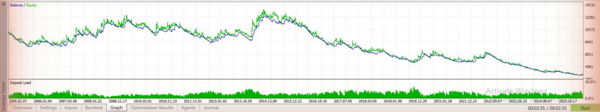

# MAP Trend Rider

**Platform:** MT5 EA + Pine strategy  
**Verdict:** Failed

## Idea
Trend following on the MAP level grid (logarithmic round numbers, halved recursively): enter on a close beyond a grid level in the SMA trend direction, stop one level back, trail level by level.

## What we found
Long-run test 2005–2026 lost money (see image).

## Files
- [`MAP_Trend_Rider.mq5`](MAP_Trend_Rider.mq5)
- [`map_trend_rider.pine`](map_trend_rider.pine)

## Charts

> **Disclaimer:** research and education only. Nothing here is financial advice or a signal service. Backtests are not live results, past performance does not predict future returns, and trading leveraged products can lose more than you deposit.
