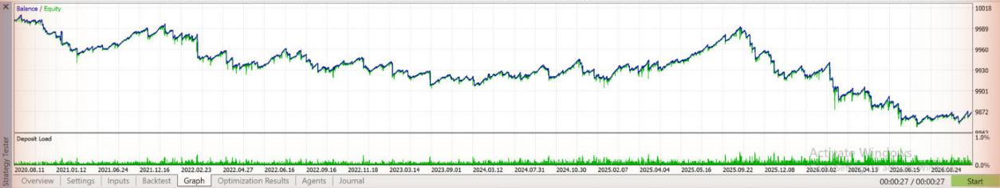
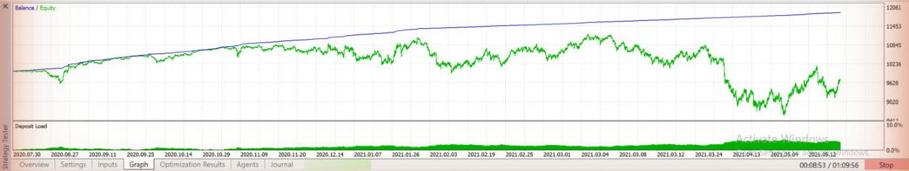

# "Shadow" grid robot re-creation

**Platform:** MT5 EA  
**Verdict:** Failed — dangerous

## Idea
OCO stop orders, then a grid against the position without a stop loss, per-position trailing.

## What we found
The balance rises smoothly while equity hides growing open losses (see image). Grid / no-stop systems look great until they don't.

## Files
- [`Shadow_Grid_Test.mq5`](Shadow_Grid_Test.mq5)

## Charts

> **Disclaimer:** research and education only. Nothing here is financial advice or a signal service. Backtests are not live results, past performance does not predict future returns, and trading leveraged products can lose more than you deposit.
