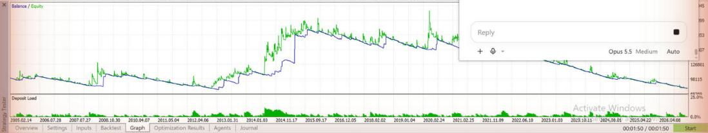
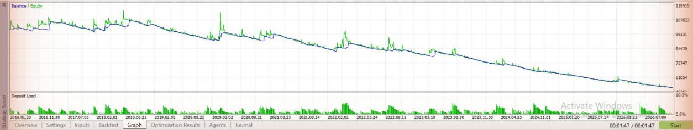

# Turtle-style trend following with pyramiding

**Platform:** MT5 EA  
**Verdict:** Failed

## Idea
Donchian breakout entries with an extra unit every k × ATR in profit, one shared trailing stop, optional SMA and swap filters.

## What we found
Steady losses in the 2016–2026 validation run (see image).

## Files
- [`Trend_Pyramid.mq5`](Trend_Pyramid.mq5)

## Charts

> **Disclaimer:** research and education only. Nothing here is financial advice or a signal service. Backtests are not live results, past performance does not predict future returns, and trading leveraged products can lose more than you deposit.
