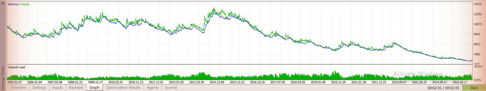

# MAP Trend Rider: trend following on round-number levels, 2005–2026

**Platform:** MetaTrader 5 (Expert Advisor) + TradingView (Pine strategy)  
**Verdict:** ❌ Failed — the long-run test from 2005 to 2026 lost money

## The hook
In [post #8](../../indicators/map-levels/) we gave away **MAP Levels**, a free indicator that draws round-number levels on any chart with one fixed rule. A map is nice to look at, but the obvious next question is: can you *trade* it?

So we built the simplest trend-following system we could on top of that grid: when price closes through a level in the direction of the trend, get on board, put the stop one level back, and let the stop climb the ladder level by level. No targets, no discretion.

Then we ran it over **21 years of data**. The chart says it all: some good years early on, a peak in 2014, and then a long, steady slide to well below where it started.

## The idea and where it came from
Two well-known ideas glued together:

- **Round numbers matter.** Traders watch "obvious" prices — 1.1000, 2000, 20,000 — and price often hesitates there. Breaking through one can be read as a sign of strength.
- **Trend following.** Only trade in the direction of the long-term trend (here a 200-period SMA), cut losers short with a tight stop, and let winners run with a trailing stop.

The MAP grid gives both pieces a fixed, objective structure: the levels define where to enter, where the stop goes and how the stop trails — all on the same ladder.

## The exact rules
All inputs below are the EA defaults in [`MAP_Trend_Rider.mq5`](MAP_Trend_Rider.mq5). The Pine version ([`map_trend_rider.pine`](map_trend_rider.pine)) uses the same grid, trend filter and risk defaults.

**Markets and timeframe:** any list of symbols in `InpSymbols` (comma separated; empty = chart symbol), so one EA can run a whole portfolio. Signals on the **daily** timeframe (`InpTF`).

**The grid**
1. Start from the power-of-ten step for the current price (e.g. 1,000 for a price in the thousands) and **halve it again and again** until the spacing is just at least **1.5 × ATR(50)** (`InpGridATR`, `InpATRLen`). That spacing `g` is the trading grid — the same halving logic as the MAP Levels tiers.

**Entry** (checked once per new daily bar, on closed bars)
2. **Long:** the last bar closed above a grid level that the bar before closed below — and, with the trend filter on, the close is above the **200-period SMA** (`InpMALen`, `InpUseTrend`).
3. **Short:** the mirror image — a close below a grid level, below the 200 SMA.
4. Enter at market on the next bar. Longs and shorts can each be switched off (`InpAllowLong`, `InpAllowShort`).

**Risk and stop**
5. Initial stop: **one grid level beyond the broken level** (for a long, one level below the level just broken).
6. Position size: **1% of equity** at risk per trade (`InpRiskPercent`), one position per symbol.

**Trailing exit**
7. No fixed target. At each new bar close the stop is moved to **one grid level behind price**, one level at a time, and never loosened. The trade ends when the stop is hit.

**Statistics:** the EA measures every trade in **R** (net result ÷ initial risk) and at the end prints the trade count, win rate, total and average R, max drawdown in R, how much of the result came from swap, an in-sample / out-of-sample split (out-of-sample from **2018**, `InpSplitYear`) and R per symbol.

## How we tested it
- MetaTrader 5 Strategy Tester, one EA on a retail broker's data.
- One long run from **2005 to 2026** — the balance/equity chart below.

## What happened
The run **lost money over the full test.**

Reading the chart:

- **2005–2014:** choppy but hopeful. The balance dipped, recovered, climbed into 2008, drifted sideways and then made its high around **late 2014**, when the big trends of that period paid off.
- **2015–2026:** the edge disappeared. From that peak the curve rolled over and **declined for more than a decade**, with only brief rallies (late 2019, 2022) that were quickly given back. It finished far below the starting balance — around a third of it.
- **Deposit load** (lower panel) stayed low the whole time, so this was not one blow-up. It was a long chain of small stop-outs that the occasional trend never paid back.

## The lesson for you
- **A good-looking map is not a strategy.** Levels can be a useful way to read a chart, but "price broke a round number" was not enough of an edge to trade mechanically on its own.
- **Look at the whole history.** Stop the test at 2014 and you would think you had found something. The next twelve years say the opposite. Always check the latest decade, not just the best stretch.
- **Tight stops + many breakouts = death by a thousand cuts.** A stop only one level away gets hit often. Trend systems need the rare big winner to pay for all of those small losses — and here they didn't come often enough.
- **Same lesson as posts #6 and #7:** simple trend following on retail CFDs had a much harder time in recent years than in the 2000s and early 2010s.

## Files
- [`MAP_Trend_Rider.mq5`](MAP_Trend_Rider.mq5) — the MT5 EA: multi-symbol, daily MAP grid breakout with SMA trend filter, one-level stop, level-by-level trailing, R-based statistics with in-sample / out-of-sample split and per-symbol report
- [`map_trend_rider.pine`](map_trend_rider.pine) — the TradingView strategy version, with an option to show the grid levels it uses
- [`MAP_MT5_equity_2005_2026.jpg`](MAP_MT5_equity_2005_2026.jpg) — MT5 balance/equity, 2005–2026
- Related: [MAP Levels indicator (post #8)](../../indicators/map-levels/)

> **Disclaimer:** Research and education only, not financial advice. Nothing here is a signal service. Backtests are not live results, past performance does not predict future returns, and trading leveraged products can lose more than you deposit.
