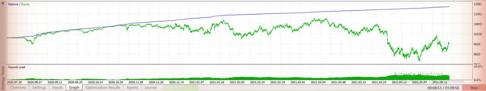
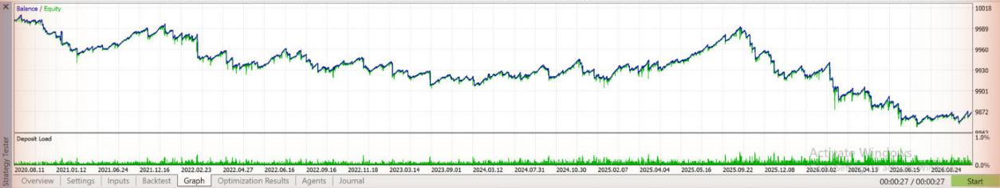

# The "Shadow" grid robot: why a smooth balance curve can hide a disaster

**Platform:** MetaTrader 5 (Expert Advisor)  
**Verdict:** ❌ Failed — dangerous

## The hook
Picture a backtest where the balance line climbs almost in a straight line: about **+20%** in under a year, barely a dip. That is exactly what our re-creation of the "Shadow" grid robot produced on real ticks (2020–2021).

Now look at the green line in the same chart. That is **equity** — what the account is actually worth with all open trades marked to market. It ended the test **below the starting deposit**.

Same robot, same test. One line says "printing money", the other says "you are losing". This post is about why.

## The idea and where it came from
"Shadow" is a grid robot whose logic was shown in a video. We rebuilt that logic from what the video showed, coded it in MQL5, and ran it on real broker tick data to see what happens behind the pretty curve.

## The exact rules
1. **OCO entry.** Place a Buy Stop above price and a Sell Stop below price (trigger distance in points, or 1 × ATR(14) on H1 if set to auto). Whichever fills first cancels the other and sets the direction of the cycle.
2. **Backward grid, no stop loss.** Every grid step *against* the position (fixed points, or 0.5 × ATR H1 on auto), the robot opens **another trade in the same direction**. None of these trades has a stop loss.
3. **Per-position trailing stop.** Once a position is in profit by the trailing trigger (default: half a grid step), a trailing stop follows it (default distance: a quarter grid step). When price comes back to an empty grid level, the position at that level is reopened.
4. **Restart.** When no positions are left, a new OCO pair is placed and the cycle starts again.
5. **Optional hourly profit target.** If equity gains a set amount within the hour, close everything and pause until the next hour.

Extras that are **off by default**: a cap on open grid positions and an equity stop (close all if equity falls a set % below balance).

## How we tested it
- MetaTrader 5 Strategy Tester, **real ticks** from the broker.
- Run 1: default rules, **no hourly target**, 2020–2021.
- Run 2: same robot **with the hourly profit target** switched on, over a longer window (2020–2026).

## What happened

### Run 1 — no hourly target (real ticks, 2020–2021)

- The **blue balance line** rises smoothly to roughly **+20%**.
- The **green equity line** follows it at first, then drifts away and keeps sinking. By the end of the test equity is **below the starting deposit**.
- The gap between the two lines is the pile of losing grid trades that were never closed. Winners get banked by the trailing stops; losers just sit there, with no stop loss, growing.

### Run 2 — with the hourly profit target (2020–2026)

Forcing a "close everything" every time the hourly target is hit keeps balance and equity close together — but the edge disappears with it. Over six years the curve just grinds slowly lower and ends below where it started.

So the robot has two modes: either it looks great while hiding growing open losses, or it is honest about its equity and doesn't make money.

## The lesson for you
- **Always look at equity, not just balance.** Balance only counts closed trades. A grid that closes winners and holds losers will always show a beautiful balance line — right up to the margin call.
- **"No stop loss" doesn't mean no loss.** It means the loss is unrealised and unlimited.
- **Grid and martingale-style systems look perfect until they don't.** They win small and often, then lose big once a trend runs against the grid.
- If someone sells you a robot with a smooth curve, ask for the **equity curve and the maximum drawdown**. If they only show balance, you have your answer.

## Files
- [`Shadow_Grid_Test.mq5`](Shadow_Grid_Test.mq5) — our MQL5 re-creation (OCO entry, backward grid, trailing, optional hourly target, optional max positions and equity stop)
- [`Shadow_realticks_no_target.jpg`](Shadow_realticks_no_target.jpg) — balance vs equity, no hourly target
- [`Shadow_realticks_hourly_target.jpg`](Shadow_realticks_hourly_target.jpg) — balance vs equity, with hourly target

> **Disclaimer:** Research and education only, not financial advice. Nothing here is a signal service. Backtests are not live results, past performance does not predict future returns, and trading leveraged products can lose more than you deposit.
