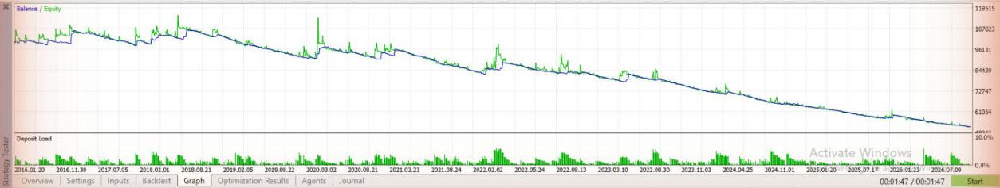
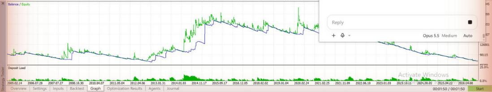

# Turtle-style pyramiding 2016–2026: adding to winners didn't save the trend

**Platform:** MetaTrader 5 (Expert Advisor)  
**Verdict:** ❌ Failed — a slow, steady bleed in the 2016–2026 validation run, ending down roughly half

## The hook
"Cut your losers, add to your winners." It is one of the oldest pieces of trading advice, and the Turtle traders of the 1980s turned it into a rulebook: buy the breakout, then keep buying more as the trend proves itself.

After [post #6](../trend-portfolio/) showed a slow monthly trend system being eaten by swap, we wanted to try the more aggressive cousin: faster breakout entries, pyramiding into winners, and a shared trailing stop. If trends pay big but rarely, pyramiding should squeeze more out of the few big ones.

It didn't. The equity curve tells the story at a glance: a few hopeful spikes, then down, and down, and down.

## The idea and where it came from
This is a **Turtle-style** system — the breakout-and-pyramid approach made famous by Richard Dennis and William Eckhardt's "Turtle" traders. The core building blocks are classic:

- **Donchian channel breakout** for entries (price closing above the highest high / below the lowest low of the last N bars).
- **Pyramiding** — adding another position ("unit") each time price moves a fixed number of ATRs in your favour.
- **One shared stop** for all units, trailed behind the trend.

We added two optional filters of our own: a long-term **SMA trend filter**, and a **swap filter** that refuses a direction when the daily overnight financing is too expensive relative to the risk — a direct lesson from post #6.

## The exact rules
All inputs below are the EA defaults in [`Trend_Pyramid.mq5`](Trend_Pyramid.mq5).

**Markets:** any list of symbols in `InpSymbols` (comma separated; empty = the chart symbol). Signals on the **daily** timeframe (`InpTF`). The EA acts **120 minutes** after a new daily bar opens (`InpDelayMin`).

**Entry**
1. Go long when a bar closes above the **55-bar Donchian** high (`InpEntryN`); go short when it closes below the 55-bar low.
2. Optional trend filter: longs only above, shorts only below the **200-period SMA** (`InpMALen`, 0 = off).
3. Optional swap filter: skip a direction if one day of swap costs more than `InpMaxSwapR` × R (0 = off).

**Sizing and pyramiding**
4. Each unit risks **0.5% of equity** (`InpRiskPercent`), with the initial stop **2 × ATR(20)** away (`InpStopATR`, `InpATRLen`).
5. Add one more unit every time price moves **1 × ATR** further in the trade's direction (`InpAddATR`), up to **4 units** per symbol (`InpMaxUnits`; 1 = no pyramiding).
6. All units share **one stop**, which is raised to 2 × ATR behind the newest unit.

**Exit**
7. The shared stop trails the opposite **20-bar Donchian** channel (`InpExitM`), or optionally a chandelier stop of k × ATR from the best close (`InpChandATR`, 0 = off).

**Statistics:** every unit is measured in **R** (net profit ÷ initial risk). At the end the EA prints total and average R, win rate, how much of the result was swap (in R), an in-sample / out-of-sample split (out-of-sample from **2018**, `InpSplitYear`) and the R result per symbol.

## How we tested it
- MetaTrader 5 Strategy Tester, one EA trading a multi-symbol basket on a retail broker's data.
- A **validation run from 2016 to 2026** (first chart below).
- A longer run from **2005 to 2026 with the swap filter switched on** (second chart below).

## What happened
**2016–2026 validation run:** the balance started around the 100k mark, spiked a few times when a trend took off, and then bled steadily for ten years. It **ended down roughly half.** The deposit load (lower panel) stayed small throughout, so this was not one blow-up — it was a long series of small losses that the occasional winning trend never paid back.

**2005–2026 with the swap filter:** the long run looked different for a while — there was a strong stretch into the mid-2010s, when the big trends of that period paid off. But from there the curve rolled over and declined for the rest of the test, giving those gains back. The swap filter did not change the overall picture: the recent decade was a steady loser.

## The lesson for you
- **Pyramiding multiplies whatever edge you have — including a negative one.** Adding to winners only helps if the entries have a real edge to begin with. If they don't, you are just making the same losing bet bigger.
- **Look at the decade, not the best stretch.** The longer run had a great period in the early-to-mid 2010s. If you only saw that part, you would think you had found something. The last ten years say otherwise.
- **Small, steady losses are the trend follower's tax.** Breakout systems lose often and wait for a few big trends. When those big trends don't come (or reverse quickly), the tax never gets paid back.
- **Measure in R, and split in-sample from out-of-sample.** The EA prints both. A system should look reasonable *after* the year you stopped tuning it, not only before.

## Files
- [`Trend_Pyramid.mq5`](Trend_Pyramid.mq5) — the EA: multi-symbol Donchian breakout, ATR-spaced pyramiding with a shared stop, Donchian or chandelier trailing exit, optional SMA and swap filters, R-based statistics with in-sample / out-of-sample split and per-symbol report
- [`Trend_Pyramid_validation_2016_2026.jpg`](Trend_Pyramid_validation_2016_2026.jpg) — balance/equity, 2016–2026 validation run
- [`Trend_Pyramid_equity_swapfilter.jpg`](Trend_Pyramid_equity_swapfilter.jpg) — balance/equity, 2005–2026 with the swap filter on

> **Disclaimer:** Research and education only, not financial advice. Nothing here is a signal service. Backtests are not live results, past performance does not predict future returns, and trading leveraged products can lose more than you deposit.
